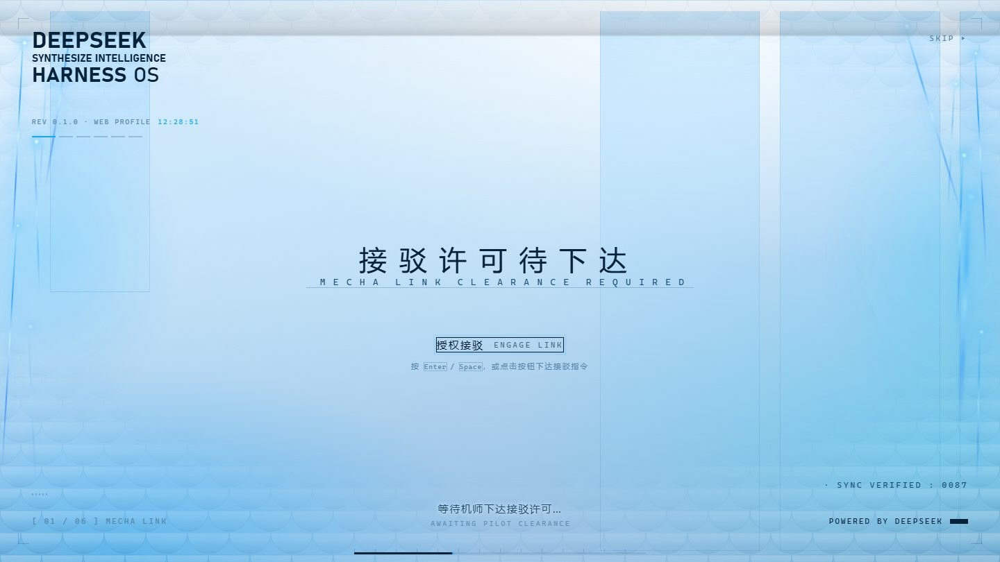
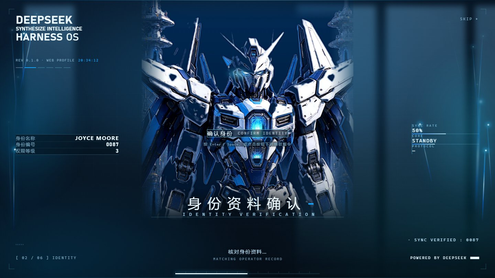

# dsh-startup-screen-mecha

> **衍生说明**：本插件是 [6shenhonghong9/dsh-startup-screen](https://github.com/6shenhonghong9/dsh-startup-screen)（MIT，原作者 **沈宏宏**）的文案与视觉改版，**不能与上游插件同时安装**。


DeepSeek Harness 的启动界面与启动动画插件。

黑幕 DeepSeek 标识 → 过曝洗白 → 天蓝机甲装甲底板（鳞片纹理 + 能量流苏）→ 五步交互式访问授权 →
色散故障揭幕。

---

## 效果预览

| 第一页 · 天蓝装甲板 | 第二幕起 · MECHA DECK |
|---|---|
| [](docs/screenshots/theme-light.jpg) | [](docs/screenshots/deck.jpg) |

> 左：第一页（黑幕之后那一页）保持天蓝装甲板。右：从「身份资料确认」开始切进机甲座舱——
> 暗色全息底板、白甲机甲头（目镜与额心核心缓慢明灭）、右侧 SYNC/CORE/PROTOCOL 读数、
> 接驳协议三选一。黑幕与第一页的版式完全不变；主题在 **设置页 →「启动动画」→ 视觉 → 主题** 里切换。

---

## 功能

**开机序列**　冷启动时播一段完整的开机动画，六幕连贯：厂牌标识 → 过曝洗白 →
天蓝装甲底板 → 五步授权 → 揭幕。中央一圈环形准星缓慢自转，缺口留在正下方，
不会挡住底部文字。

**第二幕起：机甲座舱**　黑幕与第一页保持原样；从「身份资料确认」那一页开始，
底板切成暗色全息座舱，白甲机甲头从中间升起并跟随鼠标做轻微视差，目镜与额心核心缓慢明灭；
右侧是 SYNC / CORE / PROTOCOL 三组实时读数。整个切换用一道白光盖过去，不会硬切。

**机甲皮肤**　底板是重叠半圆的**装甲鳞片**（SVG 平铺，中心淡出只压边、不抢字），
两侧垂落十几根**能量流苏**（发光细丝 + 顶端能量点，缓慢飘移），深空主题里换成青色发光线框鳞片。
两者完全由 CSS/内联 SVG 绘制，零图片、零网络请求。

**可交互，不是播片**　第一、二步要你点按钮或按 Enter 才会继续（可以关掉）。
右上角有跳过按钮，Esc 也能跳。

**交互都有声音**　身份卡的三行可以逐项点选核验（点一下亮一声「哒」），
全部点亮后确认按钮进入发光态；第三幕的「接驳协议」三选一（标准 / 静默 / 全功率），
悬停有轻响、选中有一声确认音，选择结果会同步写进右侧 PROTOCOL 读数。

**中文主字 + 英文等宽副标题**　英文副标题逐字打出来，像终端在接收数据。

**真声台词 + 界面音效**　前五句台词取自原片真声，终幕欢迎语是自制落幕词（3.73 秒）；
界面音效取自同一段素材。浏览器要求先有一次点击才准出声，所以点过按钮之后才会听到声音。

**语音没播完不会推进**　每一步停留多久由实际音频时长决定。你点得快也不会把语音掐断。

**三十三项设置**　身份名称、编号、权限等级、配色、速度、音色、语速、
开口留白、每处文案……都能在设置页实时改，改完立即生效。

---

## 播放序列

| # | 中文主字 | 英文副标题 | 需要操作 |
|---|---|---|---|
| 1 | 接驳许可待下达 | `MECHA LINK CLEARANCE REQUIRED` | 点按钮 / 按 Enter / 空格 |
| 2 | 身份资料确认 | `IDENTITY VERIFICATION` | 点按钮 / 按 Enter / 空格 |
| 3 | 接收访问需求 | `ACCESS REQUEST RECEIVED` | 自动 |
| 4 | 开始读取权限 | `PERMISSION READ STARTED` | 自动 |
| 5 | 读取完毕 · 核验通过 | `READ COMPLETE · VERIFIED` | 自动 |
| 6 | 欢迎「身份名称」访问 | `WELCOME, NAME` | 自动 |

> 第一幕（以及其前置的「机体自检中 / `MECHA SELF-CHECK`」与右下 `SYNC VERIFIED` 读数）
> 已改成**机甲口径**的同义文案：语义仍是「访问许可待授权」，只把词换到接驳 / 机师 / 同步这套。
> 真声素材 `line-1` 仍是原片那句 “Access permission required.”，两者同义不同词。

---

## 安装

```bash
dsh plugin --profile web add ./dsh-startup-screen-1.2.0.tgz
```

桌面端（DeepSeek Harness Desktop）同样支持，profile 换成 `desktop`：

```bash
dsh plugin --profile desktop add ./dsh-startup-screen-1.2.0.tgz
```

> 部分 DSH 版本会拒绝在终端里操作 `desktop` profile（提示 managed exclusively by the
> Electron application），此时请用桌面端的「插件」页安装，或按 `DESKTOP.md` 走 junction。

Windows 上也可以解压 release 压缩包后**双击「安装.cmd」**，脚本会自动识别
`web` / `desktop` 两个 profile 并逐个安装。

**装完重启 dsh web 或桌面端**（关掉启动器窗口再重新双击）。重启后刷新页面就能看到启动动画，
设置页里会多出一项「启动动画」。

### 环境要求

| 项 | 要求 |
|---|---|
| 平台 | DSH **web** profile / DSH **desktop** profile（标题栏透明仅 Windows 桌面端） |
| Node | **>= 20** |
| 依赖 | 无（不需要 `npm install`） |

### 卸载

```bash
dsh plugin --profile web remove dsh-startup-screen
```

---

## 设置选项

装好后进入 **DSH 设置页 →「启动动画」**。

### 播放

| 选项 | 默认 | 作用 |
|---|---|---|
| 启用 | 开 | 总开关，关掉就完全不播 |
| 显示模式 | 每次会话 | `每次会话` 一个浏览器会话播一次 / `总是` 每次刷新都播 / `每天` 一天一次 |
| 主题 | 天蓝机甲 | `天蓝机甲`（天蓝装甲板）/ `深空夜航`（暗座舱） |
| 速度 | 1× | 整段动画的快慢，0.35 – 3 倍 |
| 要求确认 | 开 | 第 1、2 步是否等你点按钮才继续 |
| 允许跳过 | 开 | 是否显示右上角跳过按钮、是否响应 Esc |

### 身份资料

| 选项 | 默认 | 作用 |
|---|---|---|
| 身份名称 | `JOYCE MOORE` | 终幕「欢迎 xxx 访问」里的名字 |
| 身份编号 | `0087` | 第二步身份卡上的编号，建议填数字 |
| 权限等级 | `3` | 第二步身份卡上的权限等级 |

### 语音

| 选项 | 默认 | 作用 |
|---|---|---|
| 语音播报 | 开 | 是否念台词 |
| 语音来源 | 真声素材 | `真声素材` 用内置录音 / `系统 TTS` 用浏览器合成音 |
| 音色 | 自动 | 只在用系统 TTS 时有效。留空 = 自动挑一个女声 |
| 语速 | 0.88 | 只在用系统 TTS 时有效。越慢越有旁白感 |
| 音调 | 0.85 | 只在用系统 TTS 时有效。调低更沉稳，1.0 以上会像客服播报 |
| 音量 | 0.9 | 台词音量 |
| 播报前提示音 | 开 | 念台词前先响两声轻提示，更像系统播报 |
| 开口前留白 | 240 ms | 提示音响过之后停多久再开口，0 – 1200 ms |

### 界面音效

| 选项 | 默认 | 作用 |
|---|---|---|
| 界面音效 | 开 | 文字出现、阶段推进、按钮确认的「哒」声 |
| 音效音量 | 0.5 | 界面音效音量（不影响台词） |
| 音效来源 | 内置素材 | `内置素材` 用录音 / `现场合成` 用代码合成 |

### 视觉

| 选项 | 默认 | 作用 |
|---|---|---|
| 强调色 | `#12a8ff` | 阶段条、进度条、准星的天蓝能量色 |
| 故障色 A / B | `#00e0ff` / `#3457ff` | 揭幕那下色散故障的青与靛蓝 |

### 文案

| 选项 | 默认 | 作用 |
|---|---|---|
| 品牌三行 | `DEEPSEEK` / `SYNTHESIZE INTELLIGENCE` / `HARNESS OS` | 左上角品牌块 |
| 黑幕三行 | `深度求索` / `DEEPSEEK` / `DEEPSEEK HARNESS` | 开场黑幕上的字（同义改写，机甲口径） |
| 终幕方框 | `DEEPSEEK HARNESS` | 揭幕后中央的黑底白字框 |
| 页脚 | `POWERED BY DEEPSEEK` | 右下角页脚 |

---

## 免责声明

**一、仅供学习交流。** 本项目为个人学习与娱乐性质的开源插件，不用于任何商业目的。

**二、第三方素材权利。** 本项目的视觉风格参考自动画作品，音频素材（人声与音效）
取自第三方视频，相关权利均归原权利人所有。本项目不对上述风格与素材主张任何权利，
亦未获得任何形式的授权或背书。

**三、二次创作风险自担。** 任何人基于本项目进行修改、改编、翻译、再分发等二次创作，
由此产生的侵权、纠纷或任何法律责任，均由该行为人自行承担，与本项目作者无关。

**四、商业使用风险自担。** 本项目**未授权任何商业用途**。若将本项目或其衍生作品
用于商业行为（包括但不限于售卖、付费分发、商业产品集成、商业宣传、商业演示），
由此引发的知识产权纠纷与全部法律责任，由使用者自行承担，作者不承担任何责任。

**五、许可范围。** 本项目的开源许可仅覆盖作者原创的代码与文案，
**不覆盖**上述第三方风格与素材。使用者在再利用第三方内容时，应自行取得相应授权。

**六、权利主张。** 若权利人认为本项目侵犯了其合法权益，请联系作者，
作者将在核实后立即移除相关内容。

---

## License

MIT © 沈宏宏
